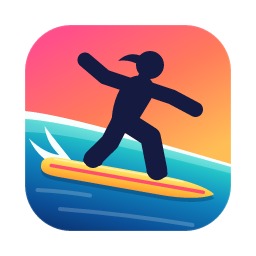

<div align="center">
  

  # Agent Flow

  Speech to text for Mac, with your highlights and screenshot paths.

  [Website](https://ethansk.github.io/AgentFlow/) · [Full setup](SETUP.md) · [Ethan's setup](https://ethansk.github.io/ethan-setup/) · [Build guide](BUILDING.md) · [Button glossary](TERMINOLOGY.md) · [GitHub](https://github.com/EthanSK/AgentFlow)

  [](LICENSE)
  
  
</div>

## Download

[Download Agent Flow v2.0.365 for Mac](https://github.com/EthanSK/AgentFlow/releases/download/v2.0.365/AgentFlow-v2.0.365-mac-universal.zip). Requires macOS 14.4 or later; supports Apple silicon and Intel. The public app is Developer ID signed, Apple notarized and stapled. Unzip it and move Agent Flow to Applications, then follow [Setup](SETUP.md).

[Release notes and checksums](https://github.com/EthanSK/AgentFlow/releases/tag/v2.0.365) · [Build from source](#build-from-source)

Updates are manual for now. The app's upstream VoiceInk check only reports releases; it does not install them over Agent Flow.

## Real-time context

Highlight text with your mouse in an app that exposes its selection to macOS, or save a macOS screenshot while recording. The black recorder shows each reference in line with your words: selections in cyan, screenshots in purple. The full context keeps that approximate order:

You can also click **Click to type** in the black recorder and write part or all of your message. The panel grows as you type, up to a quarter of the screen height, then scrolls. After you first click to type, an accepted highlight or screenshot returns focus to that editor after you release the mouse. Other app switches do not pull focus back. With the standard Shift-Control-Option shortcut, add Command to start a new recording with the editor focused. Leaving the editor only ends that text segment; finish dictation normally to paste the combined message. Enter adds a line break. Typed words stay local and are not sent to the speech-recognition model. The microphone and normal recording lifecycle remain unchanged.

```text
Rename this function

<codex_selection index="1" source="Codex" characters="32" middle_omitted="false" truncated="false">
  <text>func loadRows(from cache: Cache)</text>
</codex_selection>

and make the empty state look like this.

<local_screenshot path="/Users/you/Desktop/Screenshot 2026-09-24 at 10.41.12.png"/>
```

- Final `<text>` keeps the full captured selection, with indentation and newlines intact and no Agent Flow line/character cutoff. Earlier builds capped it at 8,000 characters; `truncated="true"` in older prompts still means text was omitted. Source apps and bridges can impose their own limits before capture. The live recorder keeps only a compact preview. Selected text is added after speech recognition, not sent to the real-time speech model. Every separate highlight stays in capture order, even without speech between highlights. A silent run can show the agent what you were reading.
- Automatic paste includes captured selections and screenshot paths for the native Codex, ChatGPT, Claude and Telegram apps; local Codex gets them through its full-prompt link. Chrome, other browsers, editors and terminals get spoken/typed prose only—even if a browser is showing a chat website. This checks the recipient, not where you highlighted the text. Telegram is included for agent chats; this does not enable reading Telegram highlights. An explicit clipboard-only finish copies the same editable draft and full-prompt links as local Codex, whichever app is focused.
- A highlight from another app uses `<app_selection source="TextEdit" bundle_id="com.apple.TextEdit">` instead of `<codex_selection>`. Chrome can also include a page title, a query-stripped URL (retaining only a validated YouTube video ID), and the selected range's DOM tag/role/label when its on-demand browser script works. Those optional fields are omitted if Chrome blocks scripting; the app name alone does not identify a tab or element. Other apps get only their app identity. Agent Flow never issues Copy to capture a highlight.
- When Codex's active task is provable, a selection also carries its stable `task_id` and current `task_title`. An uncertain task keeps the plain tag; a title alone never identifies a chat.
- VS Code code and diff editors have an early local bridge through [Better Git VS Code](https://marketplace.visualstudio.com/items?itemName=EthanSK.better-git-vscode) 1.2.99 or newer. Isolated Mac tests passed without screen-reader mode; everyday-use acceptance is still pending. One fresh mouse highlight is read through a private Unix socket, with no Copy command, network listener or stored text. Terminals, chat webviews, remote extension hosts and multiple simultaneous selections are not covered. This bridge still caps input at 8,192 UTF-16 units before Agent Flow receives it, so `characters` can undercount very large selections even though the archive no longer shortens captured text.
- A saved screenshot contributes its local path, not image pixels or an attachment. Clipboard-only screenshots are not captured. The receiving agent needs access to that file.
- For a Mode whose paste carries full context, **Advanced → Colored context** gives the authored opening a fixed 24-colour, per-word rainbow, generated locally with no model call. XML sections each keep one colour: silver speech and typing, cyan selections and magenta screenshots. The opening repeats your speech and typing for readability; the marked timeline below retains timestamps and context placement, with blank lines between metadata and content. The context skill reads the request once. Screenshot tags also include a local Markdown image reference; Codex may show this as a link rather than an inline image, and no pixels are attached. The setting is off by default and doesn't apply to local Codex drafts, which stay plain. A host or queue that does not render math may show LaTeX. Colour is omitted when it would exceed the shared 64,000 UTF-16 presentation budget; authored words, source context and screenshot links are kept. This is not a limit on the receiving app: Codex can turn large pastes into text attachments. The recorder HUD keeps its selection and screenshot colours.
- Placement is best effort because live recognition can revise earlier words. A highlight can be reading context rather than an instruction.
- The prompt viewer's top-right **Close** button asks the browser to close that tab. If the browser blocks it, use the tab's own close button; closing never deletes the saved prompt. The message footer says **Read the full prompt before answering.**
- Provisional words stay in the recorder until final delivery. The preview grows vertically to the display's safe height, then scrolls.
- Local Codex messages keep every authored word as plain, editable text, with no length cap or ellipsis. Inline `<selection>` and `<screenshot>` markers sit at their best-effort positions, protected by Markdown backticks and separated by spaces, not forced line breaks; context payloads and attributes stay in the full prompt. An opening `↗` link shares the first line with your words. The separate footer **Read the full prompt before answering.** links to the same offline viewer with a plain link label. A very large draft may become a host text attachment, but its words and links are kept. It is still one ordinary paste. The viewer shows one timeline: rainbow speech and typing, cyan selections and magenta screenshots, with expandable metadata. Opening prose identical to that timeline is not repeated; any other opening prose stays visible. Its first lines (`agent-flow-source`) and its **Source** link identify the complete plain file. Screenshot previews are embedded offline, resized to at most 2,048 pixels on the long edge; original paths stay available. Missing, unsupported or over-budget images show a fallback link instead of a blank card. The viewer accepts only decoded local PNG/JPEG/HEIC/HEIF rasters, reads at most 32 MiB per source image, and embeds at most 32 MiB of compressed previews in total. It never executes captured markup or fetches network content. Both are local files; where the viewer opens follows the host's file-opening support. The plain file retains complete captured text, timestamps, source/task labels and screenshot paths, and History keeps the complete text. **Won’t paste** and eligible recovery Copy reuse this draft and its links. Codex desktop and the audited unified ChatGPT/Codex host pairs 26.924.22138 (11645) and 26.928.20755 (12246) support this local workflow; cloud-only chats cannot read files on your Mac. Raw/skip, response and custom Modes, and the two saved-input Next routes keep their existing output.
- Completed composing prompts are also saved privately under `~/Library/Application Support/AgentFlow/Prompts/`, with unique filenames and owner-only access. Agent Flow does not automatically delete these files. They are local documents, not a cloud backup, and screenshot paths still refer to the original images. If a local-Codex prompt cannot be saved, Agent Flow leaves it unsent and offers Copy of the complete text.

For Codex to interpret this XML-style context across tasks, install the [Agent Flow context skill](.agents/skills/interpret-agent-flow-context/SKILL.md) as a personal skill. You can ask Codex: “Install `interpret-agent-flow-context` from `EthanSK/AgentFlow/.agents/skills/interpret-agent-flow-context`.” The skill reads interleaved speech, selections and screenshot paths as best-effort context; it does not upload screenshot pixels or assume every highlight is an instruction.

The expanded recorder is 1,100 points wide before your saved UI scale, constrained to fit each display. Its live context and typing area grow only until the card reaches one quarter of that display's usable height, then scroll internally; text size is unchanged.

Drag the read-only transcript/highlight area or blank control-bar space to move the floating recorder. A click in the preview still focuses typing; wheel and trackpad gestures scroll it. Dragging within the typing field continues to select text.

## Controls

Press your recording shortcut to start, then again to stop and paste. You can map a mouse button to it, but no specific mouse or companion app is required.

**Command+Enter in the floating typing input** finishes the session and sends Command+Enter after the final paste. In Codex's default Enter-to-send composer with queued follow-ups, this steers a running local chat instead of queueing the message. Ordinary Enter commits the current typed section where speech has reached at that moment, without stopping recording; Shift+Enter inserts a newline. The gesture uses the current input, not a saved destination; raw/skip mode still suppresses submission, and normal finish shortcuts keep their configured behaviour.

Press **both Command keys and both Option keys together** to start typing with the microphone off and the input focused immediately. During a session, the same chord finishes and pastes regardless of whether the floating input is focused. Hold **Shift** while pressing that chord to finish an active session with **Won’t paste**: keep the result in clipboard and History without inserting or submitting it. The Shift variant does nothing while idle. Both Command keys alone are left for your other shortcuts. You can also hold Command with the standard Shift-Control-Option start shortcut. Once typing is engaged, captured highlights and screenshots return focus to your chosen input until the session finishes. Type in the floating panel, highlight text or take screenshots, then use the normal finish action to paste once. Enter commits a typed section, and Shift+Enter inserts a newline. A typed section left open at finish follows all final speech. The microphone button enables voice when you want it; a microphone-off session sends no audio request. Speech and typed runs use `<speech>` and `<typed_text>` groups in the full context; for local Codex, that is the saved full prompt. Their `start_at`/`end_at`, and selection/screenshot `captured_at`, use compact Unix seconds with millisecond precision, e.g. `1800000000.123`. The context skill also accepts older names and ISO dates. Speech times are approximate transcript-activity times, with a five-second inactivity boundary; selection times come from mouse-up. Typing times retain the first and latest actual edit, not the later commit time; timeline placement uses the observed speech at commit and is not exact audio alignment.

While recording, press twice to finish without pasting, keeping the result on your clipboard and in History. Press three times to pause, then once to resume. Bare Escape stays with the foreground app. Another recording can start while the previous one is still transcribing.

<details>
<summary>Optional Next Track controls and other recording gestures</summary>

The **Primary button** means your normal recording shortcut. The **Next button** means macOS **Next Track**, including a keyboard media key or mapped mouse button. Next won't skip music while the recorder is visible.

| Press | When | Text goes to |
| --- | --- | --- |
| Primary | While recording | The input focused when the text arrives, like base VoiceInk |
| Next | While recording | The input where you started recording |
| Next | While transcribing, after a Primary stop | **Second chance:** the input focused when you press Next |

Only the Next routes save an exact input together with its app's Mode and auto-send. If Agent Flow can't verify that input, it shows an error instead of pasting somewhere else. The [destination guide](RECORDING_DESTINATIONS.md) has the full contract.

Primary's recording-time double-press selects **Won’t paste** and finishes to the clipboard if no third press follows; a third press in the same gesture pauses capture, and a fourth finishes with paste but no auto-send. While paused, one fresh press resumes, two select **Won’t paste** and finish to the clipboard if no third press follows, and three resume the same capture. These are recording gestures, not extra destinations. Bare Escape stays with the foreground app.

For Codex CLI or Claude Code, the terminal or editor hosting it owns the input, so the recorder shows that host's icon. Set the Mode and auto-send on the host app. No plugin or shell hook is needed.

</details>

## Ethan's setup

The [full setup website](https://ethansk.github.io/ethan-setup/) shows Ethan's hardware, mappings and companion apps. [Agentic Mouse](https://ethansk.github.io/agentic-mouse/) is a separate, optional control layer: it can trigger Agent Flow from mouse hardware, but Agent Flow records and transcribes without it.

Ethan uses GPT Live Transcribe with his own OpenAI API account, live words in the recorder, and direct-paste Modes without an extra AI rewriting step. Auto-send is configured per app rather than required by Agent Flow.

## Bring your own voice model

Create an [OpenAI API key](https://platform.openai.com/api-keys), enable API billing, and enter that key during Agent Flow setup. A fresh setup with a verified OpenAI key recommends GPT Live Transcribe for live words; a local Parakeet model remains available without a cloud key. Agent Flow stores your key in macOS Keychain and connects directly to OpenAI. There is no Agent Flow account, hosted transcription proxy, subscription, or bundled key. Existing Modes and their model choices are not silently changed by the fresh-install recommendation. Never paste an API key into a chat.

The extra voice-model hints are bounded. Dictionary terms can help recognition; recent Codex chat hints are optional and currently off in Ethan's setup. Selected text and screenshot references are assembled into the final message after recognition, not sent to the speech model. [Full setup](SETUP.md) distinguishes the app, key, macOS grants, optional browser bridge, context skill and mouse mapping.

The recorder appears on every connected monitor. Its current-app and locked-destination icons stay separate, and a two-row version/build marker identifies the running native release. Recordings can overlap with earlier transcriptions; each keeps its own Mode, input and delivery state. Genuine delivery errors remain visible.

## YouTube and Chrome companion

The optional [Agent Flow YouTube Bridge](companions/youtube-bridge/README.md) pauses a playing YouTube video when dictation starts and resumes only the video it paused. It also supports Agentic Mouse's YouTube controls, Chrome tab history and website shortcuts. Its extension, macOS helper, tests and install scripts are in this repository; install it separately with the [agent setup guide](companions/youtube-bridge/AGENT_SETUP.md).

## Build from source

Building instead of using the [public download](#download) requires **macOS 14.4 or later**, Xcode and Git. There is no Agent Flow Homebrew cask.

```sh
git clone https://github.com/EthanSK/AgentFlow.git
cd AgentFlow
./scripts/install-first-use.sh
```

The first-use installer builds an ad-hoc signed app in `~/Applications`, opens it, and refuses to overwrite an existing Agent Flow installation. `./scripts/install-first-use.sh --all` also installs the included YouTube helper, its login LaunchAgent, and the Codex context skill. Chrome extension loading, macOS permissions, provider keys, physical mouse mapping and Agentic Mouse remain separate user choices; see the [full setup and verification guide](SETUP.md). `make local` remains the build-only path that copies an app to `~/Downloads`; [BUILDING.md](BUILDING.md) covers prerequisites and troubleshooting.

The upstream `voiceink` Homebrew cask and downloads install VoiceInk, not Agent Flow.

## Documentation

- [Install the complete, optional-component setup](SETUP.md)
- [Build Agent Flow](BUILDING.md)
- [Translate Ethan's mouse-button terminology](TERMINOLOGY.md)
- [Understand the Next button and recording destinations](RECORDING_DESTINATIONS.md)
- [Read the accepted implementation learnings](LEARNINGS.md)
- [Review failed approaches before retrying delivery work](FAILED_APPROACHES.md)
- [Use the self-improving Codex/Claude Code learnings skill](.agents/skills/learnings/SKILL.md)
- [Install the Agent Flow context interpretation skill](.agents/skills/interpret-agent-flow-context/SKILL.md)
- [Review update guidance](UPDATING.md)
- [Agent Flow on GitHub](https://github.com/EthanSK/AgentFlow)

## Origin and license

Agent Flow is Ethan SK's personal fork of [VoiceInk](https://github.com/Beingpax/VoiceInk) by [Pax/Beingpax](https://github.com/Beingpax), shared in public. The native macOS foundation, model integrations and much of the app come from VoiceInk; Agent Flow adds interleaved context, destination controls, overlapping recordings and recorder UI changes. Contributor constraints live in [AGENTS.md](AGENTS.md).

This fork has no Pro purchase, trial, license validation, affiliate promotion or remote promotional announcements. Paid transcription and AI providers you configure bill you directly.

Licensed under the [GNU General Public License v3.0](LICENSE). VoiceInk and related names belong to their respective owners; Agent Flow is Ethan's independent fork.
